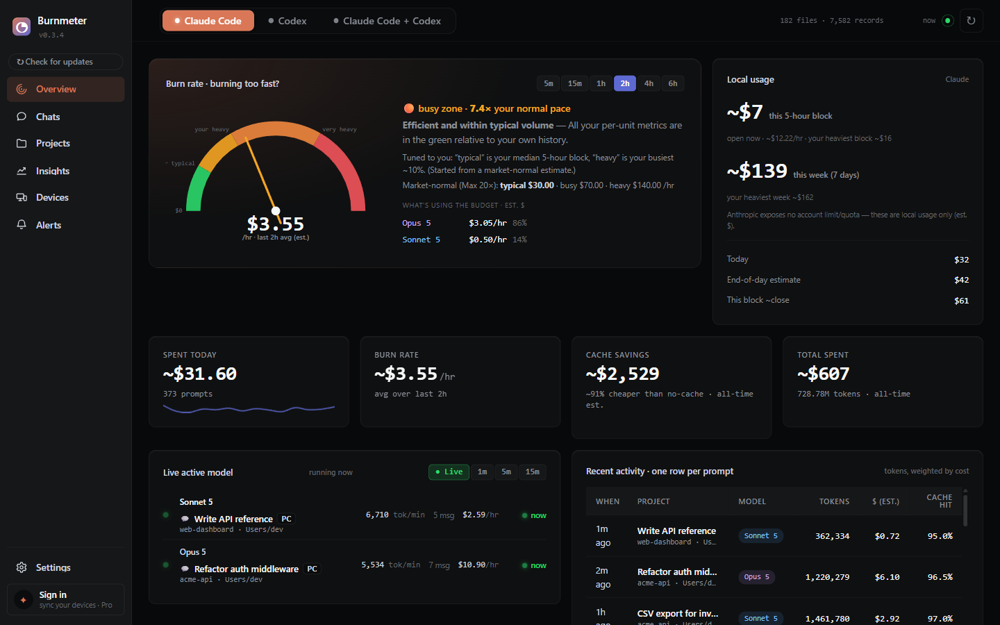
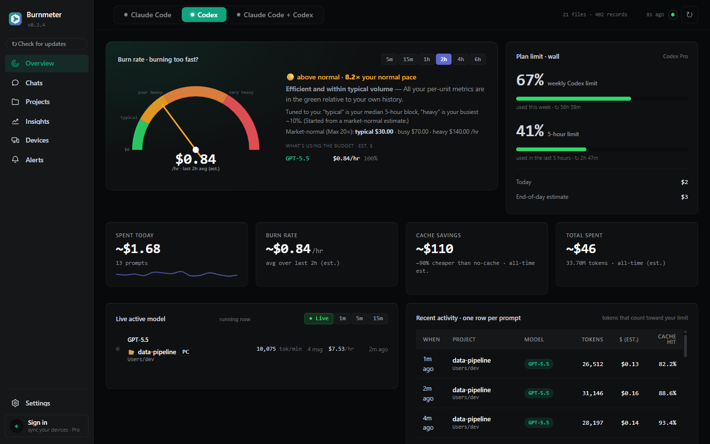

# Burnmeter

**See where your Claude Code and Codex tokens go, on your own machine.**

Burnmeter reads the session logs that Claude Code and OpenAI Codex already write
to your disk and turns them into a live dashboard: how fast you're burning, what
each project, chat and model costs, how much the prompt cache saves you, and, for
Codex (which logs it), how close you are to your plan's 5-hour and weekly limits.
No API keys, no account. Your usage data stays on your machine.



<p align="center">
  <a href="https://github.com/cihanatak/BurnMeter/releases/latest/download/BurnmeterSetup.exe"><b>Download for Windows</b></a> ·
  <a href="https://burnmeter.dev">burnmeter.dev</a> ·
  Claude Code + OpenAI Codex · v0.3.5 · <a href="./LICENSE">AGPL-3.0</a>
</p>

<sub>Screenshots show v0.3.4 with synthetic demo data: the projects, chats and numbers are made up.</sub>

## Install

### Windows

Download **[BurnmeterSetup.exe](https://github.com/cihanatak/BurnMeter/releases/latest/download/BurnmeterSetup.exe)**
from the latest release and run it. It installs for your user account only,
doesn't need Python, and runs as a desktop app with a tray icon.

The installer isn't code-signed yet, so Windows SmartScreen may say it doesn't
recognize the app. Click **More info → Run anyway**.

### macOS

You need Python 3.10 or newer. Burnmeter isn't on PyPI yet, so install it from
GitHub:

```bash
python3 -m pip install --upgrade "burnmeter[app] @ git+https://github.com/cihanatak/BurnMeter"
burnmeter
```

`burnmeter` opens the dashboard in its own window. `burnmeter serve` opens it in
your browser instead, at <http://127.0.0.1:7654>. The `[app]` extra adds the
native window and tray icon (pywebview, pystray, Pillow); without it, Burnmeter
has no third-party dependencies and uses your browser.

If pip stops with `externally-managed-environment` (common with Homebrew's
Python), install into a virtual environment, or use [pipx](https://pipx.pypa.io)
for the browser version: `pipx install git+https://github.com/cihanatak/BurnMeter`.

Linux works the same way as macOS; `burnmeter serve` is the simplest option there.

### From source

```bash
git clone https://github.com/cihanatak/BurnMeter
cd BurnMeter
python -m pip install -e .
python -m burnmeter serve
```

## What you get

- **Burn rate against your own normal.** A gauge of your current $/hour next to
  your typical, busy and heavy zones, and which models are driving it.
- **Plan limits where they exist.** Codex writes your real rate-limit usage into
  its logs, so the Codex view shows the 5-hour and weekly limits as percentages,
  with reset times. Claude Code doesn't write plan limits to disk, so Burnmeter
  does **not** show a "% of plan" for Claude; it shows your local usage and your
  own history instead of a guess.
- **Per-version model pricing.** Claude (Opus, Sonnet, Haiku, Fable) and OpenAI
  (GPT-5.x, Codex) models each at their own rate, including cache reads and 5-minute
  vs 1-hour cache writes. A model the price table doesn't know is flagged in the
  dashboard instead of being priced silently.
- **Cache savings.** Your cache hit rate, and what caching saved compared with
  paying full input price.
- **Chats, projects and commits.** Spend per chat (chat titles come from the
  Claude desktop app, if you use it), per project and per git commit.
- **Insights.** Daily trends, an activity heatmap, unusual days, and a monthly
  budget with a month-end projection.
- **Alerts.** Slack, webhook or email when Codex nears its limit or your burn rate
  runs far above your heavy zone. They are sent from your machine to destinations
  you set up.
- **Terminal statusline** and **CSV export** (see below).



## The numbers are estimates, not your bill

Burnmeter multiplies the tokens in your logs by each provider's public **API list
prices** (last checked 2026-10-29; `PRICES_VERIFIED_AT` in
[`burnmeter/pricing.py`](./burnmeter/pricing.py)). That is what the same usage would
cost through the API. If you're on a flat-fee plan such as Claude Pro/Max or
ChatGPT Plus/Pro, it is **not** what you pay. Use it to compare models, projects
and days, and to see how hard you're leaning on your plan. Your provider's console
is the source of truth for billing.

## Privacy: what stays local and what goes out

Burnmeter reads these files on your machine:

- `~/.claude/projects/**/*.jsonl` (Claude Code)
- `~/.codex/sessions/**/*.jsonl` (Codex, the last 90 days by default)
- the Claude desktop app's local chat titles, if the app is installed
- `git log` of your project folders, for per-commit cost

The dashboard server listens on `127.0.0.1` only, and it rejects API requests
whose `Host` header isn't local, which blocks DNS-rebinding attacks from other
websites.

The free app makes only these network requests:

| Request | When |
|---|---|
| `raw.githubusercontent.com`: reads the latest version number from this repo | when the dashboard opens, then every 3 hours; the tray icon checks every 6 hours |
| `github.com`: downloads the update | only when you click Update |
| your Slack, webhook or SMTP server: sends the alert message, including the numbers that triggered it (a Codex limit percentage, your burn rate or weekly spend) | only if you set up alerts |

The version check and the update download carry none of your usage data. The
charts use a bundled copy of Chart.js, so the dashboard loads nothing from a CDN.

**Pro sync** (planned, see [Pricing](#pricing)) is off unless you sign in. When on,
it uses Google Firebase:

- Your account is a Firebase Authentication email and password. Signing in sends
  the password to Firebase, as any login does.
- Each machine uploads an **encrypted snapshot** to Cloud Firestore: summary
  numbers, the last 14 days of daily cost, top projects and recent turns,
  including project names, folder paths and chat titles. The encryption key is
  derived from your password on your machine and is never uploaded, so the
  stored snapshots can't be read without your password.
- Stored **unencrypted** next to it: the device name (your computer's name unless
  you rename it) and the time of the last sync. Like any web service, Firebase
  also sees your email address, IP address and request times.

## Terminal statusline

```bash
burnmeter statusline                  # Claude Code
burnmeter statusline --source codex   # Codex
burnmeter statusline --json           # the same fields as JSON
```

Example output:

```
🟠 Opus 5.5 $4.20/h · block 4h24m · 0 err/24h · cache 97% · today $32
```

From left to right:

- **Pace:** your burn rate against your own typical, busy and heavy zones
  (🟢 🟡 🟠 🔴).
- **Model:** the one your latest session is using.
- **Burn rate.**
- **Block:** time left in the current 5-hour block. `⚠ P90+` follows it when
  this block already costs more than 90% of your past blocks.
- **Errors:** in the last 24 hours.
- **Cache:** today's cache hit rate.
- **Today:** today's spend.

When Burnmeter is running (the app or `burnmeter serve`), the command asks it for
these numbers and answers in about half a second. Otherwise it builds the line
itself from the last 26 hours of Claude Code logs. That is slower (about
9 seconds on the maker's machine), and 26 hours can't show everything. In that
case:

- the pace dot is ⚪;
- `⚠ P90+` never appears;
- the block reads `—` unless those 26 hours include a 5-hour pause.

Without a running Burnmeter, `--source codex` reads all of Codex's logs instead
of the last 26 hours. Either way the numbers come from the same code as the
dashboard.

To show the line in Claude Code, keep Burnmeter running and add this to
`~/.claude/settings.json`:

```json
{
  "statusLine": { "type": "command", "command": "burnmeter statusline" }
}
```

The `burnmeter` command comes with the pip install; the Windows app doesn't add
it to your `PATH`.

## CSV export

**Settings → Export → Download CSV** saves every parsed record as a CSV file.
With `burnmeter serve` running you can also fetch
`http://127.0.0.1:7654/api/records.csv` (add `?source=codex` for Codex).

## How it works

```
~/.claude/projects/**/*.jsonl  ─┐
~/.codex/sessions/**/*.jsonl   ─┤→ parsers → normalized UsageRecord
                                │            ↓ (in a short-lived worker process)
                                └──────────→ analytics → report JSON
                                                         ↓
                                       local dashboard on 127.0.0.1
```

Parsing runs in a worker process that exits after each build, so the long-running
server stays small. Parsed records are cached in `~/.claude` and `~/.codex`
(`.burnmeter_*_cache.json`), so later builds only re-read new or changed logs.

## Supported agents

| Agent | Logs | Status |
|-------|------|--------|
| Claude Code | `~/.claude/projects` | ✅ |
| OpenAI Codex | `~/.codex/sessions` | ✅ |
| Cursor, Copilot, Gemini CLI, others | | planned |

Adding an agent is one parser module; see [`CONTRIBUTING.md`](./CONTRIBUTING.md).

## Pricing

The local app is free and open source, with every agent and every panel. Paid
options are planned; **none are on sale yet**:

- **Pro, $6/month:** hosted, end-to-end encrypted sync across your machines.
- **Supporter, $99:** a way to back development; details at launch.
- **Commercial license, $49/year:** for organizations that can't use AGPL
  software; see [`LICENSING.md`](./LICENSING.md).

More in [`PRICING.md`](./PRICING.md).

## Contributing

Bug reports, fixes and new agent parsers are welcome. Start with
[`CONTRIBUTING.md`](./CONTRIBUTING.md); pull requests need a one-time
[CLA](./.github/CLA.md) signature, and the
[Code of Conduct](./CODE_OF_CONDUCT.md) applies. Report security problems
privately, as described in [`SECURITY.md`](./SECURITY.md).

## License

Burnmeter is free software under the
[GNU Affero General Public License v3.0 or later](./LICENSE). A commercial license
is planned for organizations that can't use the AGPL; see
[`LICENSING.md`](./LICENSING.md).
